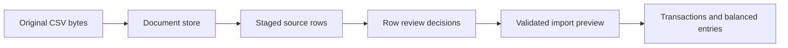

# Engineering notes

The central problem is deciding when imported evidence may change money records. Mazal keeps the original document, extracted rows, review decisions, and ledger postings as distinct records. This note follows the code in this snapshot. Tradeoff explanations are deductions from the implementation, not a claim about the author's original decision process.

## Trace a statement into review

In [StatementIntake.tsx](src/features/records/StatementIntake.tsx), selecting a CSV reads its bytes, parses or maps its columns, calculates SHA-256, and creates a statement ID. `submit` refuses to proceed when the mapping is unconfirmed, the workspace changed, or the opening balance plus rows does not match the closing balance. A balanced statement is necessary, but it does not establish that every row has the right classification.

The component uploads the original bytes to `/api/documents` before sending `stage_statement`. It verifies the response's hash, byte count, and CSV media type, checks that the returned filename is a string, and uses that server-returned filename for staging. A 60-second timeout retains the draft and explains that the original may already exist. That distinction matters because a missing response does not prove a failed write.

The [records route](server/routes/records.ts) checks the command's workspace revision. For a CSV import, it retrieves the saved original, parses those bytes again, and compares the submitted row IDs, dates, descriptions, amounts, and source references. A client cannot submit a different extraction while claiming it came from the stored CSV. This second parse costs work but moves the trust check into the component that accepts persistent changes.

`stage_statement` in [store.ts](server/store.ts) then creates an import batch with `status: 'staged'` and an empty decision list. It does not post transactions. `review_statement` stores decisions separately; `commitStatements` requires a ready preview before converting reviewed rows into ledger entries. Revising an extraction preserves its previous source and decisions in `extractionHistory`, then clears the current decisions so corrected rows require review again.

## Two different protections against duplicate edits

`commandResult` runs inside `withTransaction`, which executes `BEGIN IMMEDIATE`, commits on success, and rolls back on an exception. The request ID and payload digest address retries. The expected revision addresses stale edits. They solve different problems.

The store checks an existing request ID before checking the revision. If the same ID has the same payload digest, it returns the current snapshot without repeating the operation. The digest excludes `expectedRevision`. A response lost after a successful commit can therefore be retried without failing merely because that commit advanced the revision. Reusing the same ID for different command content fails. A new command based on an old revision fails instead of overwriting newer records.

There is also source identity. Staging checks the account and document hash, then compares the extraction digest if that source already exists. The [SQLite schema](server/persistence.ts) backs account-and-hash uniqueness with a database constraint and retains row-to-transaction references. Request identity prevents replay of an operation; source identity prevents importing the same evidence through a different operation ID. Neither proves that two differently encoded files describe different real-world events. Matching and review still matter.

## Worked example with synthetic money

Consider a cash statement with an opening balance of CAD 100.00, one debit of CAD 12.34, and a closing balance of CAD 87.66. The arithmetic in integer cents is `10000 - 1234 = 8766`. Staging this file creates one source row and advances the workspace revision, but leaves ledger transactions and account balances unchanged.

If review classifies the row as an expense, `commitStatements` calls `post` with a cash entry of `-1234` and an expense entry of `+1234`. `post` requires the sum of journal amounts to equal zero for each owner. The displayed expense amount and the signed journal entry are different concepts. Integer cents also avoid treating a floating-point rounding residue as a real monetary difference.

If the upload response disappears after the document was saved, a retry sends the same bytes and metadata. The [upload-timeout browser test](tests/desktop/statement-upload-timeout.spec.ts) covers response loss both before and after document persistence. It checks that the draft remains, no staging command was sent before verified upload, the retry creates one staged batch, and the original bytes remain recoverable. These are test assertions in the repository, not a claim that every hosted environment currently passes.

## Failure boundaries and the next experiment

A database transaction does not include the preceding document upload. An upload can succeed while staging fails, leaving an original in the document library without a committed ledger transaction. The interface acknowledges this state. Automatically deleting that original during a retry would risk deleting evidence that another operation already references.

The architecture favors explicit review and local provenance over unattended ingestion. Its costs include extra user steps, stored originals, and more state transitions. A hosted product would also need authorization on each workspace and document, rather than relying on the desktop session boundary.

The next useful experiment is process interruption at three boundaries: after original-file persistence, after the SQLite commit but before its response, and during a retried command. Use a disposable data directory and synthetic CSVs. Success means every acknowledged commit survives restart, replay creates no second transaction, and every committed source reference resolves to the exact original bytes. A leftover unreferenced original is acceptable only if the UI identifies it and recovery does not silently delete evidence.

[README validation](README.md#validation) records the actual checks and the latest failed hosted rerun. The full operating-system matrix has not passed. This documentation change does not upgrade that evidence to a release pass.
