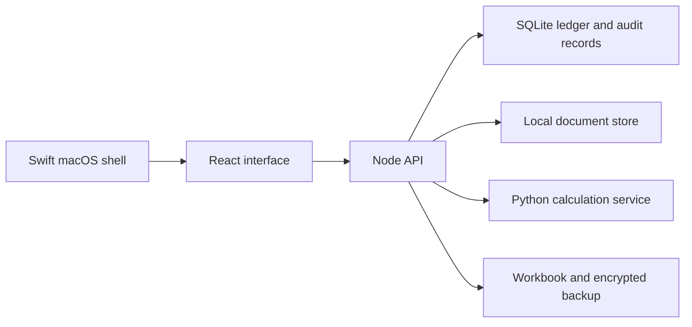

# Mazal

A local finance application that connects a transaction ledger, document review, cash-flow planning, and a Python calculation engine. React provides the interface, Node owns the local API and SQLite records, and a Swift macOS shell packages the desktop app.

[Product portfolio](https://github.com/hxssank/recruiter-portfolio)

## What the application does

- Imports statement rows into a review queue before committing them to the ledger. Source hashes and row identifiers connect transactions to the material they came from.
- Tracks accounts, recurring obligations, debt terms, spending plans, assets, and investment positions. Unknown amounts remain unknown instead of silently becoming zero.
- Links payroll records and timecards to possible bank deposits, with ambiguity and missing evidence visible to the user.
- Calculates dated cash-flow scenarios and long-term compounding plans. A separate Python service runs the numerical models.
- Exports an Excel workbook and supports encrypted backups of records and source documents.
- Uses a desktop-session token and loopback service checks for local access. The macOS shell owns desktop integration and native document helpers.

## How the pieces connect



## Code worth reviewing

| Question | Start here |
| --- | --- |
| How do imports retain their source and avoid duplicate rows? | [Statement handling](server/routes/records.ts), [SQLite constraints](server/persistence.ts) |
| How does the app separate interface code from financial calculations? | [Shared calculations](shared/), [Python models](backend/mazal_engine/), [boundary checks](scripts/check-boundaries.mjs) |
| How does it handle incomplete financial information? | [Cash preview](shared/home-cash-preview.ts), [payroll lookup](shared/payroll-lookup.ts), [planning tests](shared/planner.test.ts) |
| How does backup and recovery work? | [Automatic backup](server/automatic-backup.ts), [complete restore](server/complete-backup.ts) |
| How is the desktop app packaged? | [Native shell](macos/Mazal.swift), [packaging scripts](scripts/build-mac-app.mjs) |

## Run locally

Use the Node version in [.node-version](.node-version), the Python version in [backend/.python-version](backend/.python-version), and uv 0.13.1. The setup script checks these versions and installs the locked dependencies.

```sh
npm run setup
npm run dev
```

For a production build served locally:

```sh
npm run build
npm start
```

The server stores new records in the repository's ignored `data/` directory by default. `MAZAL_DATA_DIR` selects another directory. This repository contains application code and synthetic test cases; personal statements, balances, backups, and source documents are excluded.

On macOS, `npm run mac:build` creates the desktop package. Review the build scripts before using installation commands on an existing installation.

## Validation

On November 9, 2026, TypeScript checking and all 437 tests in `shared/*.test.ts` passed against this source snapshot. The shared tests cover money calculations, schedules, statement matching, planning, and workbook formulas. They used the existing local dependency environments.

```sh
npm run typecheck
node --test shared/*.test.ts
npm test
npm run check:release
```

The [initial hosted release check](https://github.com/hxssank/mazal/actions/runs/42689324682) failed on a stale Home-label assertion, a dialog test that assumed transparency was enabled, and two Windows filesystem assertions. The test corrections preserve backup isolation, keyboard focus, cache verification, and symlink-target checks. On November 9, 2026, the corrected source built locally, 16 focused release tests passed, and three affected Chromium checks passed against isolated synthetic records. The full Linux, macOS, and Windows matrix still needs a successful rerun; these results do not establish a fully validated release.

## Current limits

This is a personal desktop application under development. Forecasts depend on the records and assumptions entered. An apparent payroll match is evidence to review, not proof of payment. Hardware installation, clean dependency installation, and all operating-system combinations were not verified for this GitHub snapshot.

The API is designed for a local desktop session. A hosted, multi-user product would need account authentication, authorization per record, tenant isolation, managed key storage, and deployment monitoring before exposing it to the internet.
